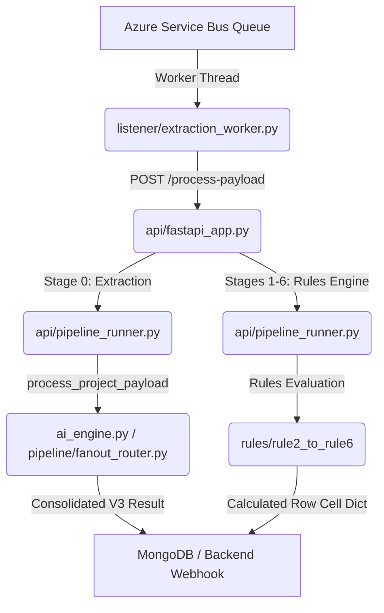
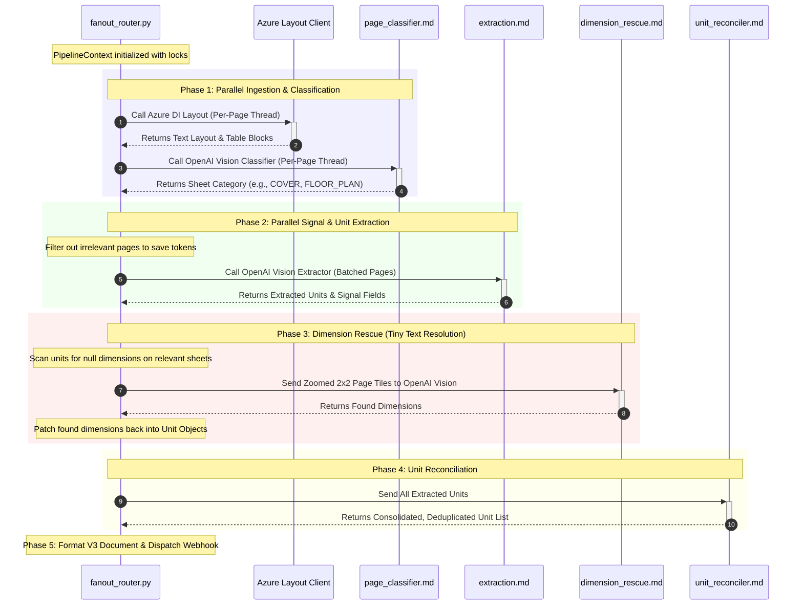

# GFS-AI Orchestration Flow Document

This document outlines the orchestration and execution flow in the GFS-AI service, coordinating background service bus listeners, FastAPI API endpoints, the rules engine, and MongoDB storage.

---

## 1. High-Level Architecture Flow

1. **Queue Listeners (`listener/`):** Background threads listen to Azure Service Bus queues (e.g. `teams-ai-integration` for Teams summaries, `ai-stage-trigger` for extraction pipelines). When a message arrives, it is parsed and forwarded to the local FastAPI app running on `/process-payload`.
2. **FastAPI App (`api/fastapi_app.py`):** Exposes endpoints that handle stage processing commands and coordinate imports.
3. **Pipeline Runner (`api/pipeline_runner.py`):** Handles rules execution for Stages 1 to 6 by reading unified documents from MongoDB, invoking the corresponding python file in `rules/`, and returning a flat `{cell_address: value}` structure.

---

## 2. Stage 0 Ingestion & Extraction Pipeline Flow

When a new project is created, the system triggers `process_project_payload` in `pipeline/fanout_router.py`. This runs a 5-phase concurrent pipeline:

### Phase Details:
* **Phase 1: Classification & Layout (Parallel):** Run Azure Document Intelligence and OpenAI Vision Page Classifier concurrently on every page of the documents. Filter out irrelevant trades (plumbing, mechanical, etc.) and save on token costs.
* **Phase 2: Signal & Unit Ingestion (Parallel):** Run Vision Extraction with the central `prompts/extraction.md` template on relevant pages.
* **Phase 3: Dimension Rescue:** Pages where glass was found but dimensions were blank are re-rendered into high-DPI overlapping grid crops (tiles). OpenAI Vision reads these tiles with the narrow `prompts/dimension_rescue.md` prompt to recover tiny numbers.
* **Phase 4: Reconciliation:** Calls `unit_reconciler.py` to reconcile and deduplicate units across drawings, details, schedules, and emails using the `prompts/unit_reconciler.md` logic.
* **Phase 5: Output & Webhook:** Generates the V3 unified schema and triggers the Node.js backend webhook to advance the proposal's stage.

---

## 3. Rules Engine Processing (Stages 1-6)

For subsequent approval loops, the FastAPI `/process-payload` endpoint triggers `api/pipeline_runner.py` which runs the rules engine:
* **Stage 2 (Glass):** Invokes `rules/rule2_glass_type.py` to resolve glass layers.
* **Stage 3 (Frame):** Invokes `rules/rule3_frame_type.py` to resolve Series 1000 vs 2000 perimeter configurations.
* **Stage 4 (Crossbeam):** Invokes `rules/rule4_cross_beam.py` to calculate structural beams.
* **Stage 5 (Add-ons):** Invokes `rules/rule5_addons.py` to calculate testing and finish options.
* **Stage 6 (Excel Generator):** Invokes `pipeline/stage6_excel.py` to compile the approved fields into a flat `{cell_address: value}` mapping, which is written to the GFS Master Excel Workbook template.
