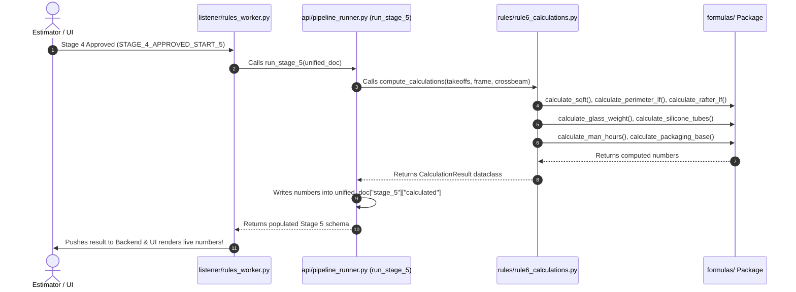

# GFS-AI Architecture & Restructuring Guide
*A Beginner-Friendly Guide to the Modular GFS-AI Pipeline & Prompts System*

---

## 1. Introduction: Why Did We Restructure?

Welcome to the GFS-AI codebase! If you wrote or worked with the original monolithic Python files, you might remember having giant 500-line multi-line strings like `EXTRACTION_PROMPT = """..."""` or `CLASSIFIER_PROMPT = """..."""` embedded directly inside `.py` files.

### Why embedding prompts in Python files was problematic:
1. **Merge Conflicts:** Every time a developer tuned prompt phrasing, it triggered git merge conflicts in critical execution code.
2. **Duplicate Instructions:** Formatting rules (like *"Output valid JSON only"*) and confidence definitions were copy-pasted across 8 different Python files. If someone changed a rule, they had to edit 8 files.
3. **No Syntax Highlighting:** Markdown prompts inside triple quotes (`"""..."""`) had no linting, spellcheck, or markdown previewing in IDEs.

### The Solution: Modular Prompt Decoupling
We moved all prompt text into dedicated `.md` files under the **`prompts/`** folder. Python modules now contain **only execution logic** and load prompts dynamically via a single loader: `load_prompt("filename.md")`.

---

## 2. Code Mapping Matrix (Where Did My Code Move?)

If you're looking for a specific prompt or module you previously wrote, here is the exact migration map:

| Original Monolithic Location | New Modular Location | Purpose |
| :--- | :--- | :--- |
| `classifier/prompt.py` (Pass 1 prompt) | `prompts/1.classifier_pass1_system.md` | Pass 1 email relevance filter & signal extraction. |
| `classifier/prompt.py` (Pass 2 prompt) | `prompts/2.classifier_pass2_system.md` | Pass 2 project candidate matching & structured summary. |
| `extraction/extraction_prompt.py` | `prompts/6.extraction.md` | Main architectural blueprint visual extractor. |
| `extraction/page_classifier.py` (`CLASSIFIER_PROMPT`) | `prompts/5.page_classifier.md` | Visual 200 DPI sheet relevance classifier. |
| `extraction/dimension_rescue.py` (`DIMENSION_RESCUE_PROMPT`) | `prompts/7.dimension_rescue.md` | Zoomed-in tile dimension & blueprint font reader. |
| `extraction/unit_reconciler.py` (`RECONCILER_SYSTEM_PROMPT`) | `prompts/8.unit_reconciler.md` | Multi-sheet glass unit deduplication & merger. |
| `listener/teams_worker.py` (hardcoded chat/meeting strings) | `prompts/3.teams_chat.md` & `4.teams_meeting.md` | Microsoft Teams channel chat & meeting transcript summarizers. |
| *New Global Rules* | `prompts/0.common_instructions.md` | Shared JSON output rules & confidence definitions. |
| *New Loader Utility* | `prompts/prompt_loader.py` | Reads `.md` files and prepends global rules automatically. |
| *New Summary Enricher* | `extraction/summary_enricher.py` | Combines Phase 1 context with Stage 0 CAD dimensions. |

---

## 3. How `prompt_loader.py` Works

In your Python code, instead of writing multi-line strings, you simply import `load_prompt`:

```python
from prompts.prompt_loader import load_prompt

# Loads 5.page_classifier.md and automatically prepends 0.common_instructions.md!
CLASSIFIER_PROMPT = load_prompt("5.page_classifier.md")
```

---

## 4. The 2-Phase Summary & Reasoning Architecture

When an email arrives, we do not make the user wait 45 minutes for CAD extraction to finish. Instead, we use a **Two-Phase Lifecycle**:

1. **Phase 1 (Pre-Extraction):** Generated in ~2 seconds. Sanitizes attachment names (filtering out internal Outlook `email-*.txt` cache files) and provides immediate context for the Sales Manager.
2. **Phase 2 (Post-Extraction):** Generated at Stage 0 completion. Binds verified unit dimensions (`60.0" × 60.0"`), frame series (`Series 1000`), and engineering specs without consuming extra LLM tokens.

---

## 5. Deep Dive: How Prompts Are Managed, Loaded, and Ingested

To keep the pipeline robust, easy to debug, and lightning-fast, prompts follow a strict **3-Stage Ingestion Lifecycle**:

### A. The Prompts Directory Layout
All prompts live in the `/prompts` folder at the repository root and follow a numeric sequence matching the execution lifecycle:
```text
prompts/
├── 0.common_instructions.md    # Global rules (strict JSON formatting, confidence scale definitions)
├── 1.classifier_pass1_system.md # Pass 1 Email relevance filter & signal extraction
├── 2.classifier_pass2_system.md # Pass 2 Project candidate matching & structured summary
├── 3.teams_chat.md             # Microsoft Teams channel chat summarizer
├── 4.teams_meeting.md          # Microsoft Teams meeting transcript summarizer
├── 5.page_classifier.md        # Architectural blueprint 200 DPI visual sheet classifier
├── 6.extraction.md             # Main CAD blueprint drawing element visual extractor
├── 7.dimension_rescue.md       # High-DPI zoomed-in tile dimension & blueprint font reader
├── 8.unit_reconciler.md        # Multi-sheet glass unit deduplication & reconciler
└── prompt_loader.py            # Dynamic prompt reader and global rule injector
```

### B. The 3-Step Ingestion & Stitching Lifecycle
When any AI worker or engine module needs to call Azure OpenAI, prompt ingestion proceeds as follows:

1. **Step 1 — Zero Code Coupling (Disk Read):**
   * Python modules do not hardcode text. They call `load_prompt("filename.md")`.
   * Prompts can be updated, edited, or reviewed directly in Markdown without altering Python source files.
2. **Step 2 — Automatic Global Instruction Prepending:**
   * `prompt_loader.py` dynamically checks if `0.common_instructions.md` exists.
   * If found, it automatically prepends global JSON formatting constraints (`"Output valid JSON only"`, `"Never wrap in markdown fences"`) and the standardized 3-tier confidence scale (`HIGH`, `MEDIUM`, `LOW`) to every prompt.
3. **Step 3 — Runtime Dynamic Parameter Binding:**
   * Templates use Python-safe format placeholders (e.g. `{candidates}`, `{channel_name}`).
   * The Python worker formats dynamic runtime context into the prompt right before calling the LLM.

### C. Azure OpenAI Call Execution & Safety Cleaning
When the prompt is dispatched to Azure OpenAI:
* **Role Separation:** The loaded template is passed as the `system` prompt, while dynamic email bodies or CAD image blocks are passed as the `user` prompt.
* **Deterministic Configuration:** Calls use `seed=42` and `response_format={"type": "json_object"}` to guarantee valid structured JSON returns.
* **Safety JSON Cleaner:** If an LLM ever includes surrounding text or markdown code fences, `clean_json_text()` strips the fences and parses the JSON safely.

---

## 6. Modular Formulas Architecture & Pipeline Execution Lifecycle

Just like we decoupled prompts into `/prompts`, we centralized all mathematical, material, and fabrication formulas into a modular library under **`/formulas`**.

### A. Directory Structure of `/formulas`
```text
formulas/
├── __init__.py          # Clean public exports for the entire engine
├── geometry.py          # calculate_sqft, calculate_outer_dimensions, calculate_perimeter_lf, calculate_rafter_lf
├── materials.py         # calculate_glass_weight, calculate_silicone_tubes
├── fabrication.py       # calculate_man_hours, MAN_HOURS_BASE lookup
└── packaging.py         # calculate_packaging_base
```

### B. Where and When the Pipeline Accesses These Formulas
Formulas are invoked at three distinct points in the project lifecycle:

1. **Stage 0 (Extraction Finish):**
   * **Invoking Module:** `extraction/summary_enricher.py`
   * **Formulas Accessed:** Dimension formatting (`width_in × length_in`) and unit grouping.
   * **Action:** Synthesizes the Phase 2 Enriched Technical Scope and writes to `project.aiAnalysis.summary`.

2. **Stage 5 (Calculations & Add-ons Trigger):**
   * **Trigger Message:** `STAGE_4_APPROVED_START_5` received on Azure Service Bus.
   * **Invoking Chain:** `listener/rules_worker.py` $\rightarrow$ `FastAPI /process-payload` $\rightarrow$ `api/pipeline_runner.py:run_stage_5` $\rightarrow$ `rules/rule6_calculations.py:compute_calculations` $\rightarrow$ `formulas.*`.
   * **Formulas Accessed:**
     * `calculate_sqft(width_in, length_in, panel_count)`
     * `calculate_outer_dimensions(width_in, length_in, panel_count)`
     * `calculate_perimeter_lf(outer_w, outer_l)`
     * `calculate_rafter_lf(vertical_rafters, length_in, horizontal_rafters, outer_w)`
     * `calculate_glass_weight(sqft, 15.0)`
     * `calculate_silicone_tubes(perimeter_lf, rafter_lf, lf_per_tube=8.0)`
     * `calculate_man_hours(frame_code, total_rafters)`
     * `calculate_packaging_base(frame_code)`
   * **Action:** Populates `unified_doc["stage_5"]["calculated"]` (`total_sqft`, `total_weight`, `perimeter_lf`, `silicone_tubes`) and returns to backend to render live in the Estimator UI.

3. **Stage 6 (Excel Generation):**
   * **Trigger Message:** `STAGE_5_APPROVED_START_6`.
   * **Invoking Module:** `pipeline/stage6_excel.py` $\rightarrow$ `config/workbook_map.py`.
   * **Action:** Maps calculated values and case-sensitive trigger characters (`"Y"` vs `"y"`) into exact Excel cell addresses (`D109`, `C128`, `D38`, etc.).

### C. Sequence Diagram of Pipeline Formula Access


---

## 7. End-to-End API Service Tests (Real System Case)

Below are the exact request and response payloads from a real project case (**1500 Clinton Street / Victor Rossi / FM Construction Group**).

### Service 1: Email Ingestion & Two-Pass Classification
**Endpoint / Consumer:** `listener/worker.py` $\rightarrow$ `classifier/classifier.py`

#### **Incoming Service Bus Request Payload:**
```json
{
  "correlationId": "sb-msg-1500-clinton-001",
  "receivedDateTime": "2026-08-08T10:15:00Z",
  "payload": {
    "subject": "Quote Request: 1500 Clinton Street - Walkable Skylight Panels",
    "sender": "victor@fmconstructiongroup.com",
    "fromName": "Victor Rossi",
    "toRecipients": ["sales@glassfloor.com"],
    "ccRecipients": [],
    "bodyText": "Hi GFS Team,\n\nWe are preparing a bid for the 1500 Clinton Street renovation project in Hoboken, NJ. We need supply and engineering for the rooftop walkable skylights specified in the architectural set. Please find attached our architectural floor plans and framing details. We need pricing by next Wednesday.\n\nThanks,\nVictor Rossi\nFM Construction Group, LLC\nPhone: (201) 555-0199",
    "documents": [
      {
        "documentId": "doc-001",
        "originalName": "A-101_Roof_Plan.pdf",
        "blobUrl": "https://gfsstorage.blob.core.windows.net/leads/A-101_Roof_Plan.pdf"
      },
      {
        "documentId": "doc-002",
        "originalName": "A-104_Skylight_Sections.pdf",
        "blobUrl": "https://gfsstorage.blob.core.windows.net/leads/A-104_Skylight_Sections.pdf"
      },
      {
        "documentId": "doc-003",
        "originalName": "email-AAMkADhkOWU2MmEwLTVhM2UtNDJhMS1iY2ZkLWExZDBjOWM5ODQwYgBGAAAA.txt",
        "blobUrl": "https://gfsstorage.blob.core.windows.net/leads/email-temp.txt"
      }
    ]
  }
}
```

#### **Output Response from AI Classifier:**
```json
{
  "classification": "NEW_PROJECT",
  "confidence": 0.95,
  "summary": "- Customer Info: Victor Rossi from FM Construction Group, LLC\n- Location: 1500 Clinton Street, Hoboken, NJ\n- Scope: Rooftop walkable skylights for residential renovation project\n- Request Summary: Quoting and engineering estimate requested for upcoming bid submission by next Wednesday\n- Attachments: A-101_Roof_Plan.pdf, A-104_Skylight_Sections.pdf\n- Sender Name: Victor Rossi\n- Sender Email: victor@fmconstructiongroup.com\n- Company Name: FM Construction Group, LLC",
  "reasoning": "No matching project records found in database for 1500 Clinton Street, Hoboken, NJ. Creating a new project opportunity with 95% confidence for Victor Rossi requesting rooftop walkable skylights.",
  "address": "1500 Clinton Street, Hoboken, NJ",
  "matchedProjectId": null
}
```

---

### Service 2: Stage 0 Drawing Extraction & Reconciler
**Endpoint / Consumer:** `listener/extraction_worker.py` $\rightarrow$ `new_app/fanout_router.py`

#### **Incoming Extraction Request Payload (`POST /process-payload`):**
```json
{
  "message_id": "sb-stage0-1500-clinton-001",
  "project_id": "66b4e18d9f1234567890abcd",
  "trigger": "BEGIN_EXTRACTION",
  "subject": "Quote Request: 1500 Clinton Street - Walkable Skylight Panels",
  "sender": "victor@fmconstructiongroup.com",
  "documents": [
    {
      "documentId": "doc-001",
      "originalName": "A-101_Roof_Plan.pdf",
      "blobUrl": "https://gfsstorage.blob.core.windows.net/leads/A-101_Roof_Plan.pdf?sas=token"
    },
    {
      "documentId": "doc-002",
      "originalName": "A-104_Skylight_Sections.pdf",
      "blobUrl": "https://gfsstorage.blob.core.windows.net/leads/A-104_Skylight_Sections.pdf?sas=token"
    }
  ]
}
```

#### **Output Response from Stage 0 Drawing Extractor:**
```json
{
  "status": "EXTRACTION_DONE",
  "output": {
    "units": [
      {
        "unit_label": "WS-1 Walkable Skylight (North Bay)",
        "width_inches": 72.0,
        "length_inches": 48.0,
        "panel_count": 2,
        "page": 2,
        "dimension_label_type": "GLASS",
        "confidence": "HIGH",
        "verbatim": "72\" x 48\" WALKABLE ROOF SKYLIGHT (2 EQUAL PANELS)",
        "citation": "A-101_Roof_Plan.pdf"
      },
      {
        "unit_label": "WS-2 Walkable Skylight (Center Deck)",
        "width_inches": 60.0,
        "length_inches": 60.0,
        "panel_count": 1,
        "page": 2,
        "dimension_label_type": "ROUGH_OPENING",
        "confidence": "HIGH",
        "verbatim": "5'-0\" x 5'-0\" STRUCTURAL GLASS SKYLIGHT OVER LIVING AREA",
        "citation": "A-101_Roof_Plan.pdf"
      }
    ],
    "frame_signals": {
      "frame_type_stated": {"value": "SERIES_1000", "confidence": "HIGH"},
      "install_type": {"value": "PEDESTAL", "confidence": "HIGH"},
      "assembly_type": {"value": "FA", "confidence": "HIGH"}
    },
    "glass_signals": {
      "is_walkable": {"value": true, "confidence": "HIGH"},
      "is_exterior": {"value": true, "confidence": "HIGH"},
      "has_air_gap": {"value": true, "confidence": "HIGH"},
      "has_conditioned_space_below": {"value": true, "confidence": "HIGH"}
    },
    "addon_signals": {
      "has_nanodot": {"value": true, "confidence": "HIGH"},
      "has_krypton": {"value": true, "confidence": "HIGH"}
    }
  }
}
```

---

### Service 3: Post-Extraction Enriched Technical Summary
**Module:** `extraction/summary_enricher.py` $\rightarrow$ Rendered on Frontend `AIInsight.tsx`

#### **Final Synthesized Enriched Summary Output:**
```markdown
- Customer Info: Victor Rossi from FM Construction Group, LLC
- Location: 1500 Clinton Street, Hoboken, NJ
- Verified Scope: WS-1 Walkable Skylight (North Bay) (72.0" × 48.0"), 2 panel(s) [Sheet p.2]; WS-2 Walkable Skylight (Center Deck) (60.0" × 60.0"), 1 panel(s) [Sheet p.2]
- Engineering & Framing: Frame: Series 1000, Mount: Pedestal, Assembly: FA, Walkable Glass, Exterior Application, Air Gap / Insulated, NanoDot Anti-slip, Krypton Gas Filled
- Request Summary: Quoting and engineering estimate requested for upcoming bid submission by next Wednesday
- Attachments: A-101_Roof_Plan.pdf, A-104_Skylight_Sections.pdf
- Sender Name: Victor Rossi
- Sender Email: victor@fmconstructiongroup.com
- Company Name: FM Construction Group, LLC
```

#### **Final Synthesized Enriched Reasoning Output:**
```text
No matching project records found in database for 1500 Clinton Street, Hoboken, NJ. Creating a new project opportunity with 95% confidence for Victor Rossi requesting rooftop walkable skylights. | Post-Extraction Analysis: Successfully extracted and reconciled 2 physical glass units on sheet(s) 2. Confirmed exact dimensions from CAD callouts and schedule tables. Identified Series 1000 frame with walkable glass, exterior application, insulated air gap, NanoDot anti-slip coating based on engineering specifications.
```
