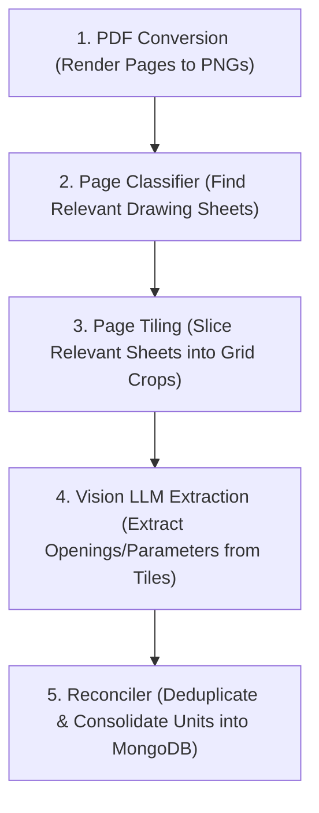

# Stage 0 Layout Ingestion Pipeline: Optimization Strategy

## Part 1: What is the Actual Process & Output Format?
The Stage 0 Ingestion Pipeline consists of 5 main steps:



### The Output Formats:

#### Vision Tile Extraction Output:
The Vision LLM outputs a raw JSON array matching our schema in `prompts/extraction.md`. For each crop, it outputs:
```json
{
  "units": [
    {
      "unit_label": "Walkable Opening A",
      "width_inches": 72.0,
      "length_inches": 48.0,
      "panel_count": 3,
      "citation": "covers region (12.5, 4.0) to (19.0, 11.0)"
    }
  ],
  "glass_signals": { "is_walkable": { "value": true, "citation": "..." } }
}
```

#### Reconciliation Output:
Multiple tiles will inevitably see the same unit (since tiles overlap). The Reconciler takes these overlapping records, merges duplicates based on location descriptions and dimensions, and produces a single unified JSON:
```json
{
  "project_id": "123",
  "units": {
    "A": { "value_width_in": 72.0, "value_length_in": 48.0, "extracted_citation": { "pdf_name": "...", "page_num": 2, "bbox_inches": [12.5, 4.0, 19.0, 11.0], "raw_citation": "..." } }
  }
}
```
This is what gets saved to MongoDB and loaded by the frontend.

---

## Part 2: Why is it taking 1 hour for a 60-page PDF?
A 60-page blueprint PDF is a massive payload. The 1-hour execution time is caused by three primary bottlenecks:

### Bottleneck A: Fixed Grid Tiling Explosion (The "Multiplier" Effect)
Vision models (like `gpt-4o`) have input resolution limits. They cannot read a tiny 1/16" font size on a massive 36"x24" blueprint sheet. To solve this, the pipeline slices each page into an overlapping grid (e.g., 3x3 = 9 tiles).

If 20 out of 60 pages are classified as relevant, and we use a 3x3 grid: 
$$20\text{ pages} \times 9\text{ tiles} = 180\text{ images to process!}$$

Making 180 separate LLM vision requests sequentially or in small batches takes a massive amount of time.

### Bottleneck B: Azure Rate-Limiting (429 Backoffs)
Azure OpenAI enforces Tokens Per Minute (TPM) and Requests Per Minute (RPM) limits.
* Sending 180 high-resolution images instantly triggers HTTP 429 (Rate Limit Exceeded).
* The code must wait (sleep) for 30–60 seconds repeatedly to let the rate limit reset, adding huge delays.

### Bottleneck C: Single-Threaded PDF-to-Image Conversion
Converting 60 pages of vector PDF into high-quality 200 DPI PNGs is CPU-intensive. Doing this in a single Python thread blocks execution for several minutes before the AI even starts.

---

## Part 3: How Can We Improve the Efficiency? (Brainstorming)
Here are the high-impact architectural changes we can make to bring the processing time down from 1 hour to under 3 minutes:

### 1. Downscaled Classification (DPI Optimization)
* **What we do now:** Render all pages at a high resolution (e.g., 200 DPI).
* **Optimization:** Render the initial pages at a very low resolution (e.g., 75 DPI). This takes less than 2 seconds. The Page Classifier only needs low-res text to see if a page is a "Detail page" or a "Schedule". Only render the classified relevant pages at 200 DPI for visual extraction.

### 2. Adaptive Tiling / Region Detection (Instead of Fixed Grids)
* **What we do now:** Slice every relevant page blindly into a 3x3 grid (9 tiles), even if 80% of the page is empty margin space.
* **Optimization:** Run a fast local layout detector (or a quick OCR pass) to find where drawings actually exist on the page. Only crop the bounding boxes where data is present. This can cut the number of tiles per page from 9 down to 2 or 3.

### 3. True Async Concurrency (asyncio HTTP Calls)
* **What we do now:** Use standard Python threads or sequential loops to send API requests.
* **Optimization:** Rewrite the vision client dispatch using `asyncio` and `httpx.AsyncClient`. This allows sending all 50+ tiles concurrently. The bottleneck then shifts entirely to the API throughput.

### 4. Batch API (Azure OpenAI Batch) --------- not feasible as we cant wait for 24 hrs overnight 
If real-time latency is less critical than cost and rate limits, we can use the OpenAI Batch API. You upload all 180 tiles in a single batch file, and OpenAI processes them offline within 24 hours at 50% of the cost and with separate rate limits (no 429 backoffs). (Useful for overnight queue runs).
