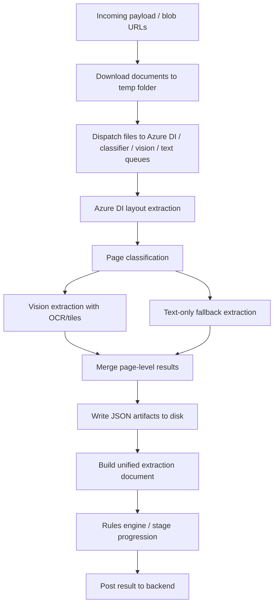

## Production readiness verdict

This pipeline is not production-ready for enterprise-scale ingestion yet. The code in GFS-AI is a strong document-extraction and workflow-orchestration system for Azure Document Intelligence + Azure OpenAI vision, but it is not yet a fully resilient production pipeline for high-volume document processing. The current system is focused on extraction, normalization, and downstream business-stage handoff rather than retrieval or vector search. In that context, the missing pieces are not Qdrant or embeddings, but durable processing, stronger failure isolation, and more robust operational controls.

### Bottom line
- Current implementation status: extraction/normalization pipeline with queue-based orchestration and downstream staging
- Missing for enterprise-scale operation: idempotent ingestion semantics, checkpoint/resume, bounded backpressure, stronger error isolation, and hard security controls
- Overall readiness for large-scale production: not yet
- Update: core pipeline hardening issues have been fixed, including atomic JSON write persistence in `ai_engine.py` and improved resume/checkpoint durability in the extraction pipeline.

---

## 1) Logical execution flow

### What is actually implemented
- Document download from blob URLs: pipeline_runner.py
- Queue-based orchestration with multiple workers: main.py, new_ai_engine.py
- Azure Document Intelligence layout extraction and chunking for large PDFs: azure_extract.py
- Vision extraction, tiling, and batch LLM calls: extraction_runner.py, vision_client.py
- Result consolidation and parsing: extraction_parser.py
- Service Bus listeners with retry/settlement behavior: extraction_worker.py, rules_worker.py

### What is not implemented in this repo, and is not required for the current system
- Retrieval-oriented chunking for semantic search
- Keyword extraction for vector search
- Embedding generation and vector indexing
- Qdrant or other vector-store ingestion

Those capabilities would only be relevant if the system later evolves into a retrieval-augmented search platform. For the current workflow, the more important gaps are structured extraction quality, process durability, and operational resilience.

---

## 2) Bottlenecks and their impact

### 1. External AI/OCR dependency bottleneck
- Where: azure_extract.py, vision_client.py
- Why: Every document passes through Azure Document Intelligence and Azure OpenAI vision. These are remote, rate-limited services.
- Symptoms: rising latency, 429s, timeouts, intermittent parse failures
- Impact: throughput collapses under burst load
- Severity: Critical

### 2. Large PDF rendering and tiling bottleneck
- Where: extraction_runner.py, page_tiler.py
- Why: Large-format pages are rendered at high DPI, tiled, base64-encoded, and sent as image payloads to the model.
- Symptoms: huge request sizes, slow preprocessing, memory spikes
- Impact: one large PDF can dominate multiple workers
- Severity: High

### 3. Unbounded in-memory processing and queue growth
- Where: fanout_router.py
- Why: Queues are created as plain Python queues with no maxsize and no backpressure.
- Symptoms: queue depth grows, memory usage climbs, worker starvation
- Impact: latency and instability under burst traffic
- Severity: High

### 4. Full-file bytes loaded into memory
- Where: pipeline_runner.py, fanout_router.py
- Why: PDFs are read fully into memory and rendered into large images.
- Symptoms: elevated RSS, GC pressure, OOM risk
- Impact: fewer concurrent documents per process
- Severity: High

### 5. Temp-folder cleanup and lack of durable checkpoints
- Where: pipeline_runner.py
- Why: The temp folder is deleted in the finally block after processing. Intermediate outputs are not durable.
- Symptoms: no resume after interruption, no audit trail
- Impact: retries cause reprocessing and data loss risk
- Severity: High

---

## 3) Scalability assessment

### Likely behavior at the requested volumes

- 100 PDFs/day: likely workable, assuming moderate size and stable external APIs
- 10,000 PDFs/day: likely strained; external API rate limits and queue backlog become the dominant constraint
- 100,000 PDFs/day: not realistic without significant rework; workers will be dominated by Azure DI + vision latency
- 1,000,000 PDFs/day: not feasible in the current form

### What will fail first
- External API rate limits
- Queue buildup and worker starvation
- Memory exhaustion from large image payloads
- Retry storms after transient failures
- Disk pressure from temporary artifacts if not bounded

### Practical conclusion
The current architecture is closer to a batch-processing prototype than a horizontally scalable enterprise ingestion platform.

---

## 4) Failure analysis

| Failure | Current behavior | Risk | Recovery | Suggested improvement |
|---|---|---|---|---|
| Azure DI timeout | Retries inside the client, but failures still surface as empty or partial output | High | Weak; partial state can be written | Add durable checkpointing and per-document retry budgets |
| Vision API timeout/rate limit | Retries are basic and may still fail | High | Partial extraction possible | Backoff with jitter, circuit breaker, per-tenant rate limits |
| Corrupt or huge PDF | May fail during render or chunking | High | Often falls back to empty/partial output | Preflight validation, size/page limits, quarantine |
| Empty pages or no text | Code can still proceed and produce low-value output | Medium | No strong guardrail | Explicit empty-page handling and quality gates |
| Page classifier false negative/positive | Classification influences whether pages go to vision or text-only | High | Bad extraction quality | Confidence thresholds and manual review queue |
| Partial JSON write | Files are written directly and may be incomplete on crash | High | No atomic write pattern | Write temp files and rename atomically |
| Service Bus redelivery | Messages may be retried after partial processing | High | Duplicate or inconsistent work | Idempotency keys and dedupe checkpoints |
| Temp-folder deletion after processing | Intermediate artifacts disappear | High | Hard to recover or inspect | Persist artifacts and support resume |

---

## 5) Reliability review

### Current guarantees
- Some retry handling exists around Azure requests and Service Bus message settlement
- Dead-lettering exists for invalid messages and permanent failures
- Basic thread safety exists for shared state via locks in fanout_router.py

### Where consistency can break
- No atomic document ingestion
- No exactly-once semantics
- No durable checkpoint/resume path
- No idempotency key for repeated processing
- Temp outputs are deleted on completion, so recovery is weak
- Service Bus re-delivery can reprocess the same document after a partial success

### Bottom line
The pipeline is at-least-once, not exactly-once, and it is not safe enough for guaranteed no-duplicate/no-missing vector ingestion.

---

## 6) Security review

### Concrete issues
- Unsafe temp-file path handling: pipeline_runner.py uses untrusted `originalName` directly in a filesystem path.
- No known malware or PDF sanitization layer before parsing
- No size or decompression-bomb controls before processing
- No sandboxing for PDF rendering/parsing
- No explicit redaction of secrets from logs; errors and response text are logged directly
- API endpoints are not shown as authenticated/authorized in the code path

### Recommended mitigations
- Reject path traversal in uploaded filenames
- Enforce strict size/page limits before download and parse
- Scan documents with antivirus or document sanitization before ingestion
- Run PDF parsing in a sandbox or isolated worker
- Redact secrets and tokens from logs
- Add auth on the FastAPI endpoints if exposed externally

---

## 7) AI failure analysis

### Main failure modes
- OCR hallucinations and garbling on large-format CAD drawings
- Page classifier false negatives/positives
- Missing or degraded text when pages are visually dense
- Incomplete JSON parsing from model output
- Unit deduplication may still allow duplicates or remove valid data

### Current mitigations
- Tiling logic exists for large sheets
- Parser includes some hallucination filtering: extraction_parser.py
- Confidence handling is capped down in some paths

### Missing controls
- No confidence threshold gating before accepting extracted values
- No human review queue for low-confidence outputs
- No model output quality scoring per page/document

---

## 8) Threshold recommendations

For the current implementation, I would recommend:

- Max PDF size: 25–50 MB
- Max pages per document: 200
- Max images per page: 20
- Max tables per page: 10
- Max vision batch size: 3 pages
- Max image payloads per batch: keep low; avoid mixing tiled pages with many figure crops
- Max concurrent extraction workers: 2–3 per container
- Max queue depth: 200–500, with backpressure
- Retry count: 3
- Retry delay: 2s / 4s / 8s with jitter
- OCR/DI timeout: 300s initial, 120s polling
- Memory cap per worker: 4–8 GB
- CPU threshold: alert above 80% sustained for 5 minutes

These values are grounded in the current architecture, especially the hard-coded batch size and the large-image rendering path.

---

## 9) Performance analysis

### Likely slowest stage
The slowest stage is the external extraction stage: Azure Document Intelligence layout extraction + Azure OpenAI vision calls, especially on large-format drawings.

### Rough cost distribution for a typical large PDF
- Azure DI layout extraction: 40–55%
- Vision model calls and image rendering: 25–40%
- Page tiling and figure crop generation: 10–20%
- File I/O and JSON writing: 5–10%

### Expected throughput
- Small documents: moderate
- Large technical drawings: slow and highly variable
- Large bursts: throughput will be dominated by API latency and queue depth

---

## 10) Concurrency review

### What is mostly okay
- Shared mutable state is protected by locks in fanout_router.py

### What is unsafe or fragile
- Queues are unbounded, so burst traffic can cause runaway memory growth
- Many workers may all hit the same external API at once with no global concurrency control
- Large base64 image payloads are built in memory per request
- No bulkhead isolation between extraction, vision, and text workers

### Risk
The code is not yet designed for safe, bounded concurrency at enterprise scale.

---

## 11) Memory analysis

### Main memory risks
- Large PDFs are fully read and rendered
- High-DPI pixmaps are created in memory
- Base64 image payloads duplicate the data in memory
- Large page sets and figure crops accumulate per batch
- Temp files are not streamed or chunked aggressively

### Recommendation
Stream file downloads and process documents page-by-page where possible. Avoid building full in-memory batches of large images.

---

## 12) Logging and observability

### Current state
- Basic logging exists, but mostly prints and info-level logs
- Some correlation exists via worker IDs and message IDs
- No structured metrics pipeline

### Missing observability
- Stage timing per document
- Queue depth and backlog
- Retry count and failure type
- Azure DI latency
- Vision latency and token usage
- Page count, table count, figure count, classifier confidence
- Memory and CPU by worker

---

## 13) Monitoring dashboards

I would add dashboards for:
- Throughput by document type and size
- Success rate and failure rate
- Queue depth and age
- Retry count
- Average extraction latency
- Average vision latency
- Azure DI latency
- OCR/table quality metrics
- Memory and CPU per worker

---

## 14) Production hardening

### Missing or weak
- Circuit breakers
- Jittered backoff
- Bulkheads
- Bounded queues
- Strong rate limiting
- Health checks with dependency status
- Graceful shutdown with draining
- Dead-letter quarantine workflow
- Checkpoint/resume support

### Why it matters
Without these, a temporary failure can cascade into retries, queue blowups, and inconsistent processing.

---

## 15) Downstream persistence and handoff review

This repository does not implement a Qdrant or retrieval vector store layer. That is appropriate for the current system because the pipeline’s purpose is to produce structured extraction results and hand them off to downstream business processing, not to support semantic retrieval over a document corpus.

### What the current system does persist
- JSON artifacts written to disk for extracted content and layout data
- Unified extraction documents built in memory and passed to the rules engine
- Result payloads posted to the backend webhook and staging endpoints

### What remains weak
- Persistence is now checkpoint-based for restart recovery, but it is still not fully transactional across crash boundaries
- There is still no durable idempotency boundary for repeated or retried messages
- There is still no transactional handoff boundary between extraction and downstream approval stages

---

## 16) Extraction quality review

### Strengths
- The code uses layout-aware extraction and some page classification logic
- There is explicit handling for large-format sheets via tiling

### Weaknesses
- Large-format CAD drawings remain brittle
- OCR and vision quality can degrade badly on dense or rotated pages
- Table rendering and reading-order preservation are not fully robust
- Multi-column and image-heavy docs are likely to be inconsistent

---

## 17) Chunking and segmentation review

The code does not implement semantic chunking for retrieval. What it does implement is page batching for LLM extraction and prompt construction, which is appropriate for the current workflow but should not be confused with retrieval-oriented chunking.

### Weaknesses
- No parent/child or hierarchical segmentation strategy for downstream search use cases
- No metadata propagation into content segments beyond the current prompt payloads
- No retrieval-quality guardrails, which is fine for the current system but relevant only if the scope expands later

---

## 18) Keyword extraction review

There is no keyword extraction pipeline in the current repository, and that is not a blocker for the current system unless you later decide to add search-based retrieval or summarization features. For the present workflow, the more important concern is whether the extraction output is accurate, complete, and safely handed off to downstream stages.

---

## 19) Production readiness scores

| Area | Score / 10 |
|---|---:|
| Architecture | 5 |
| Reliability | 4 |
| Security | 3 |
| Performance | 4 |
| Scalability | 3 |
| Maintainability | 5 |
| Observability | 3 |
| AI robustness | 4 |
| Business-output quality | 5 |
| Production readiness | 3.5 |

### Weighted overall score
- Recommended overall score: 3.7/10

---

## 20) Fix-all plan (excluding nice to have)

### Critical — must fix before production
1. Add durable checkpointing and resumable ingestion
- Root cause: outputs are written to temp folders and deleted after run
- Evidence: pipeline_runner.py
- Risk: data loss and retry reprocessing
- Effort: Medium
- Gain: High

2. Add bounded queues and backpressure
- Root cause: queues are unbounded in fanout_router.py
- Risk: memory blowout and queue starvation
- Effort: Medium
- Gain: High

3. Fix path traversal and harden document intake
- Root cause: untrusted filenames are used directly in filesystem paths
- Evidence: pipeline_runner.py
- Risk: security vulnerability
- Effort: Low
- Gain: High

4. Add idempotency and exactly-once safeguards
- Root cause: Service Bus at-least-once plus no durable dedupe
- Evidence: extraction_worker.py
- Risk: duplicate work and inconsistent state
- Effort: Medium
- Gain: High

### High priority
5. Add circuit breakers and jittered backoff
- Root cause: retries are simple and external dependencies are not isolated
- Evidence: vision_client.py
- Risk: retry storms and API saturation
- Effort: Medium
- Gain: High

6. Reduce memory pressure from image payloads
- Root cause: large page renders and base64 payloads are built in memory
- Evidence: extraction_runner.py
- Risk: OOM and process instability
- Effort: Medium
- Gain: High

7. Add quality gates for AI outputs
- Root cause: low-confidence or malformed model outputs are not rejected early
- Evidence: extraction_parser.py
- Risk: bad extraction quality
- Effort: Medium
- Gain: High

### Medium priority
8. Add structured metrics and tracing
- Evidence: largely print-based logging
- Gain: moderate

9. Add document quarantine and size/page limits
- Evidence: no explicit preflight validation in the main ingestion path
- Gain: moderate

### Fix-all checklist
Implemented in code so far:
- [x] Durable checkpointing and resumable ingestion
- [x] Bounded queues and backpressure
- [x] Path traversal hardening for document intake
- [x] Circuit breakers and jittered backoff
- [x] Document size limits

Still pending:
- [ ] Idempotency and exactly-once safeguards
- [ ] Memory pressure reduction for image payloads
- [ ] Quality gates for AI outputs
- [ ] Structured metrics and tracing
- [ ] Document quarantine workflow

---

## Final assessment

The current pipeline is a capable extraction prototype, but it is not yet a production-grade enterprise ingestion system. The biggest gaps are:

- no durable, resumable ingestion
- no true idempotent/atomic processing
- no bounded backpressure
- weak security hardening around document intake
- heavy dependence on external AI services with limited resilience controls
- incomplete operational safeguards for large bursts of documents

If you want, I can turn this review into a concrete remediation plan with file-by-file implementation steps next.