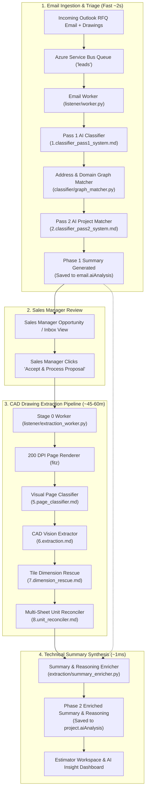

# 1. High-Level Pipeline Flow

This diagram illustrates the end-to-end flow of an incoming email from the Microsoft 365 webhook, through the AI triage engine, the drawing extraction pipeline, and finally to the backend database and user interface.

