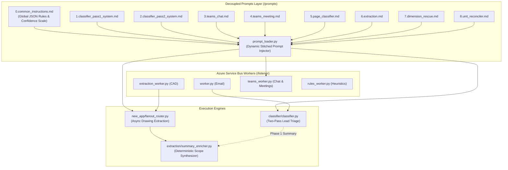

# 2. Proposed High-Level Architecture

This diagram illustrates the decoupling of monolithic prompt strings into standalone `.md` files managed by `prompt_loader.py`, alongside the 2-phase summary synthesis engine.

