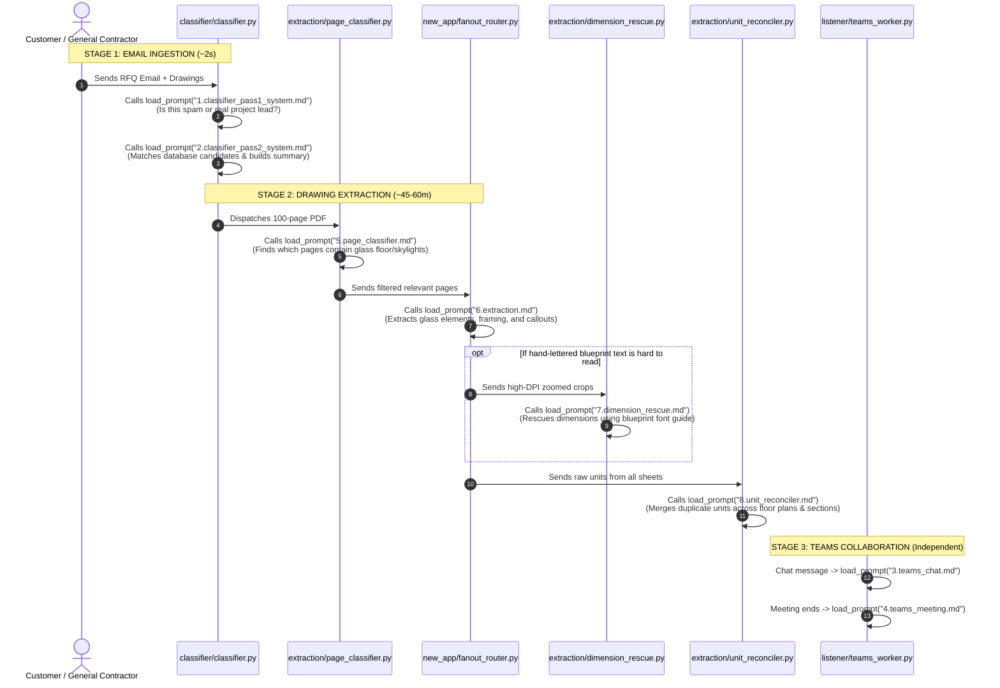

# 4. Pipeline Journey & Prompt Mapping (Who Calls Which Prompt?)

This sequence diagram shows the step-by-step lifecycle of an RFQ and maps each Python module to the exact `.md` prompt file it invokes.

