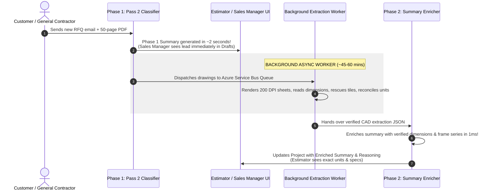

# 5. Production Lifecycle for a Brand-New Project

This diagram shows how the system guarantees 0-second UI blocking for the Sales Manager while safely running the heavy 45-minute CAD drawing extraction in the background, followed by instant 1-millisecond summary enrichment.

