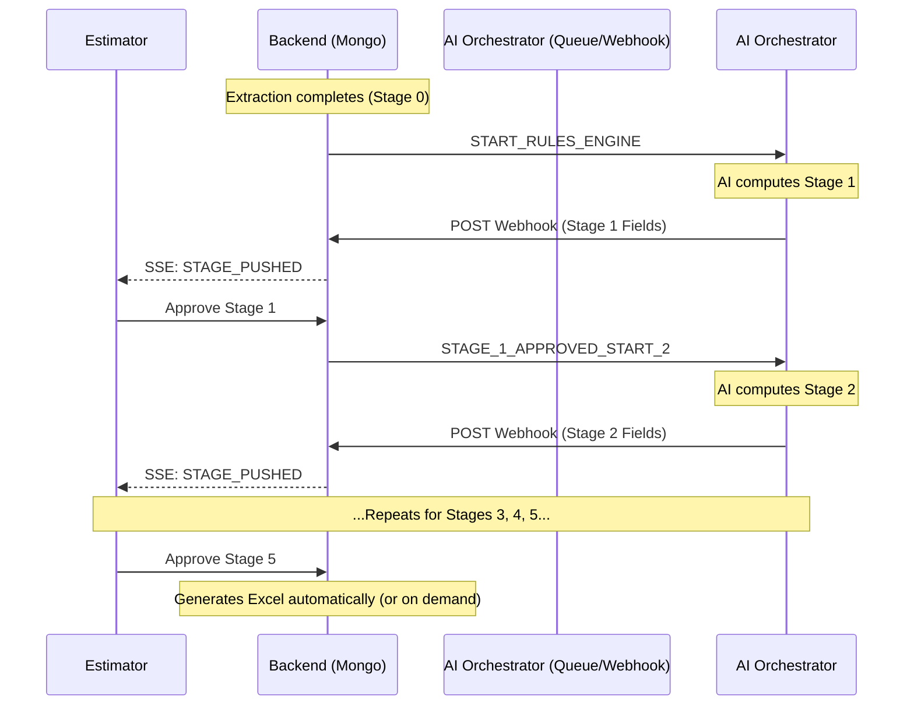

# AI Backend Population of Parameters

This document explains the fully schema-driven architecture for the GFS Proposal Pipeline, specifically detailing how the AI orchestrator, backend, estimator UI, and Excel generator interact.

## Architecture & Flow

MongoDB is the single source of truth. Every change is immutable and versioned. The general workflow is:



## Schema Paths vs Indices

The backend no longer addresses parameters using generic `(row, column)` indices. Instead, everything uses strict **schema paths**. 

✅ **Valid Paths:** `stage_1.project_name`, `stage_2.glass_type`, `units.A.value_width_in`, `stage_5.addons.duty`
❌ **Invalid Paths:** `stage1[0]`, `{ row: 12, col: 4 }`

## Pipeline Triggers (Azure Service Bus)

When a stage is approved, the backend automatically publishes a trigger message to the `ai-stage-trigger` Azure Service Bus queue.

| Trigger Event Name | When it Fires | Target Stage |
| --- | --- | --- |
| `START_RULES_ENGINE` | Document extraction finishes | 1 |
| `STAGE_1_APPROVED_START_2` | Estimator approves Stage 1 | 2 |
| `STAGE_2_APPROVED_START_3` | Estimator approves Stage 2 | 3 |
| `STAGE_3_APPROVED_START_4` | Estimator approves Stage 3 | 4 |
| `STAGE_4_APPROVED_START_5` | Estimator approves Stage 4 | 5 |
| `STAGE_5_APPROVED_START_EXCEL` | Estimator approves Stage 5 | 'EXCEL' |

## Postman API Testing Routes

To simulate the entire end-to-end flow using Postman, you will need to alternate between pushing fields as the AI (via the webhook) and approving them as the Estimator.

### 1. Push AI Stage Output (Inbound Webhook)
**POST** `http://localhost:3000/api/v1/proposals/webhooks/ai-stage-result`
*(No Auth token required)*

**Body:**
```json
{
  "projectId": "YOUR_PROJECT_ID",
  "stage": 1,
  "idempotencyKey": "unique-run-1",
  "aiRunId": "run_1",
  "fields": [
    { "fieldPath": "stage_1.project_name", "value": "4 Jane Street" },
    { "fieldPath": "stage_1.project_address", "value": "New York, NY" }
  ]
}
```

### 2. Review Stage Data (Frontend/Estimator UI)
**GET** `http://localhost:3000/api/v1/proposals/YOUR_PROJECT_ID/stages/1`
*(Requires Bearer Auth Token)*

This returns `fields_to_show`. Note that internal `_signals` will not be returned here.

### 3. Estimator Modifies a Field (Optional)
**PATCH** `http://localhost:3000/api/v1/proposals/YOUR_PROJECT_ID/field`
*(Requires Bearer Auth Token)*

**Body:**
```json
{
  "fieldPath": "stage_1.project_name",
  "value": "4 Jane Street - Modified"
}
```

### 4. Estimator Approves Stage
**POST** `http://localhost:3000/api/v1/proposals/YOUR_PROJECT_ID/stages/1/approve`
*(Requires Bearer Auth Token)*

**Body:** `{}`

*Approving this stage will automatically emit `STAGE_1_APPROVED_START_2` to the Azure Service Bus queue.*

### 5. Repeat for Stages 2-5
Send a new webhook payload for `stage: 2` (using `"stage": 2`, `"idempotencyKey": "unique-run-2"`, etc.), then approve Stage 2. 
Send a new webhook payload for `stage: 3`, then approve Stage 3.
(And so on up to Stage 5).

### 6. Generate Excel
**GET** `http://localhost:3000/api/v1/proposals/YOUR_PROJECT_ID/excel`
*(Requires Bearer Auth Token)*

This will generate and download the final `.xlsx` document directly from the completed schema!
