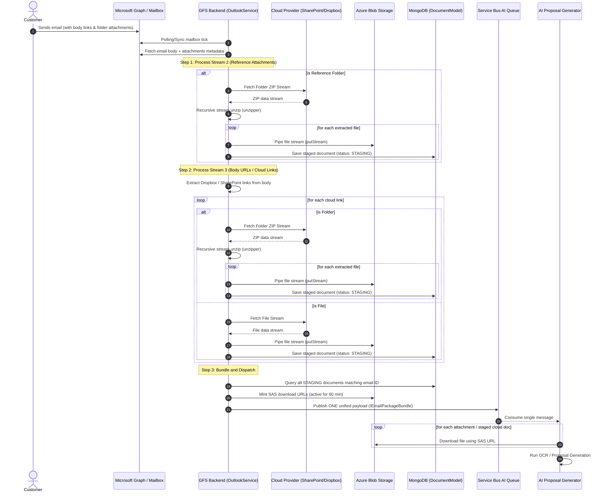

# Handover Guide: Unified Email Ingestion & AI Dispatch Workflow

This document details the complete end-to-end ingestion pipeline for emails, attachments, and cloud folders, showing how everything is processed and dispatched to the AI system in a single, unified message.

---

## 1. End-to-End Workflow Diagram



---

## 2. Ingesting & Bundling Everything for AI

Instead of triggering separate AI analysis calls for each file or link, the GFS backend staging architecture collects all files and publishes a **single message** containing the email body and all resource files.

### The Ingestion Bundle Structure
The payload sent to the AI queue (`IEmailPackageBundle`) contains:

```json
{
  "correlationId": "outlookEmail:668d2a149c95cb384210ab56",
  "messageId": "AAMkAGI2...",
  "conversationId": "AAQkADg3...",
  "sender": "customer@bidders.com",
  "to": ["sales@gfs.com"],
  "subject": "Spring Lake District Library - Plans & Drawings",
  "bodyText": "Hi, I have attached the plans here... \n\n--- CLOUD LINK INGESTION WARNINGS ---\n[WARNING] Failed to automatically download: https://dropbox.com/unsupported-link...\nReason: Provider resolution is not supported in this version.",
  "receivedDateTime": "2026-07-07T16:00:00.000Z",
  "attachments": [
    {
      "originalName": "sheet1.dwg",
      "mimeType": "application/octet-stream",
      "size": 154200,
      "storageKey": "documents/staging/outlook/...",
      "downloadUrl": "https://gfs.blob.core.windows.net/documents/...&sig=sasToken"
    },
    {
      "originalName": "specifications.pdf",
      "mimeType": "application/pdf",
      "size": 2450000,
      "storageKey": "documents/staging/cloud-link/...",
      "downloadUrl": "https://gfs.blob.core.windows.net/documents/...&sig=sasToken"
    }
  ]
}
```

### Components of the Ingest Bundle

1. **Email Metadata**: Standard metadata for threading and correlation (`conversationId`, `messageId`, `correlationId`).
2. **Augmented Email Body**: The `bodyText` includes the original email text, plus a warning block listing any cloud link downloads that failed (so the AI/user knows what requires manual action).
3. **MINTED SAS URLs**: High-security, short-lived (60 min) Shared Access Signature URLs are generated dynamically for:
   * Standard binary email attachments.
   * Files extracted from reference attachment folders.
   * Files extracted/downloaded from body cloud links (OneDrive/SharePoint/Dropbox).
4. **AI Consumption**: The AI consumes the queue message once, has immediate read access to the email context, and downloads all related documents in a single, high-efficiency batch.
