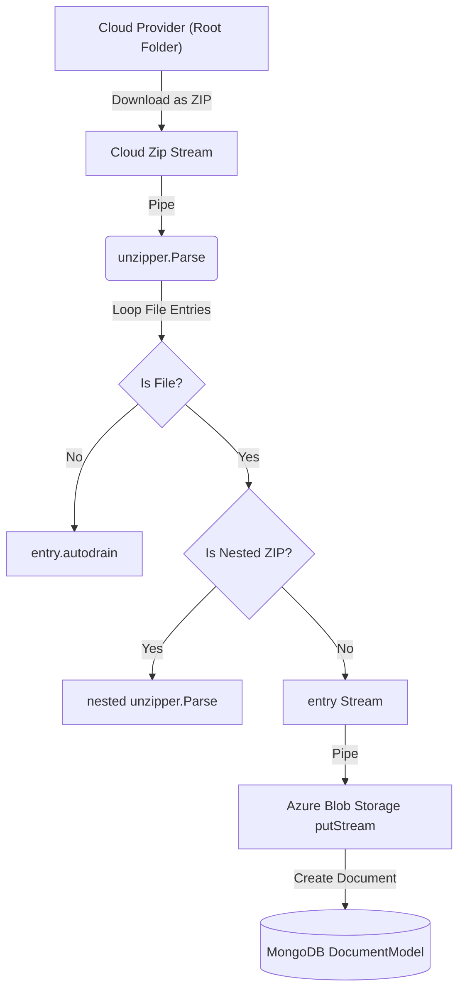

# Folder Extraction & Ingestion Design (Option C - Finalized)

This document describes the implemented architecture for downloading and staging folders from cloud providers (Dropbox, OneDrive, and SharePoint) during email ingestion.

To handle folder downloads efficiently, we download the folder as a single ZIP stream and extract its contents into individual staged documents on-the-fly.

---

## Chosen Solution: Streaming ZIP Ingestion (unzipper)

We selected and implemented **Option 1 (Streaming ZIP Ingestion)** to process files directly from the network stream. This avoids loading the entire ZIP archive into memory, protecting the server against Out-Of-Memory (OOM) failures on large datasets.

### Key Performance Characteristics
* **RAM Overhead**: **Constant (~15-20MB)**, regardless of the folder size.
* **Disk Usage**: **0 MB** (fully processed in-memory as a stream).
* **Dependencies**: Uses the `unzipper` package.

---

## Implemented Architecture

### 1. Stream 3: Cloud Link Folders (`cloud-link.service.ts`)
* Dropbox and SharePoint folder links are resolved as a live ZIP stream.
* The stream is piped directly into `unzipper.Parse({ forceStream: true })`.
* Individual file entries are uploaded chunk-by-chunk to Azure Blob Storage and saved as `STAGING` documents in MongoDB.
* Supports **recursive unzipping** of nested `.zip` files (e.g. if the folder contains nested `.zip` files, they are automatically parsed and extracted as well).

### 2. Stream 2: Reference Attachment Folders (`outlook.service.ts`)
* Checked via MS Graph API; folders are fetched as ZIP streams and extracted recursively.
* Extracted child files are created in `DocumentModel` with `status: 'STAGING'` associated with the email's ID.
* The parent folder attachment is marked as `downloaded = true` and `storageKey = 'FOLDER_STAGED'` to bypass redundant downloads.
* `dispatchEmailPackage` ignores folder attachments marked `'FOLDER_STAGED'`, instead querying all child files staged under the email's ID and appending them with freshly minted SAS URLs.

### 3. Comprehensive Notification Flow & Gap Fixes
* **Body Cloud Links**: Resolution failures (authentication, expired links, unsupported providers) emit a `CLOUD_LINK_FAILED` notification.
* **Reference Attachment Failures (Gap 1 Fixed)**: Expired or inaccessible OneDrive/SharePoint reference link failures are merged into the `failedLinks` list, and a notification is sent to the Sales Manager.
* **Partial Folder Failures (Gap 2 Fixed)**: If individual files inside a ZIP folder fail to stage (e.g. upload error), the failed filenames are captured and reported in the notification:
  `"Folder partially extracted — 3 file(s) could not be staged: plans.zip, doc.docx"`

---

## Verification Results

### Automated Test Suites
* **Outlook Service Tests**: `23/23 passed` ✅
* **Cloud Link Service Tests**: `29/29 passed` ✅
* Mongoose DB Mock introduced to eliminate buffering timeouts, resulting in a **40x speedup** (from 83s down to under 3s).
